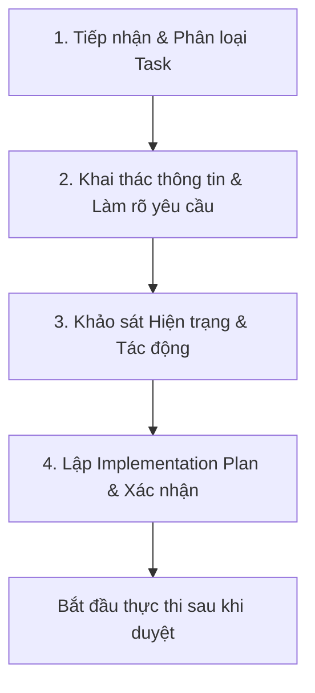

# Quy trình Tiếp nhận & Xử lý Task (/task)

Kỹ năng này đảm bảo agent luôn có **đầy đủ thông tin, không giả định mơ hồ và lập kế hoạch rõ ràng** trước khi can thiệp vào mã nguồn.

---

## 4 Bước thực hiện khi nhận lệnh `/task [nội dung task]`

---

### Bước 1: Tiếp nhận & Phân loại Task (Intake & Classification)

1. Trích xuất mục tiêu cốt lõi từ nội dung người dùng cung cấp sau `/task`.
2. Phân loại nhiệm vụ:
   - 🌟 **Feature (Tính năng mới):** Cần giao diện mới, API mới, migration database?
   - 🐛 **Bug Fix (Sửa lỗi):** Hành vi thực tế khác gì với kỳ vọng? Các bước tái hiện lỗi?
   - ⚡ **Optimization / Refactor (Tối ưu hóa):** Hiệu năng, giảm dung lượng, tái cấu trúc code?
   - 🎨 **UI / UX Improvement (Giao diện):** Cải thiện bố cục, màu sắc, animation, responsive?
   - 🔌 **Integration (Tích hợp):** Kết nối bên thứ 3 (ngân hàng, AI, push notification...)?

---

### Bước 2: Khai thác thông tin & Làm rõ yêu cầu (Requirements Clarification)

Trước khi bắt tay vào làm, chủ động làm rõ các điểm sau. Nếu người dùng chưa nêu rõ, hãy sử dụng công cụ `ask_question` hoặc hỏi trực tiếp:

1. **Phạm vi không gian (Spaces):**
   - Áp dụng cho **Sổ Cá nhân**, **Sổ Gia đình**, hay **Cả hai**?
2. **Quyền hạn & Phân quyền (Permissions):**
   - Ai được thực hiện thao tác này? (Mọi thành viên, chỉ tác giả, hay chỉ Chủ gia đình - Owner)?
3. **Luồng dữ liệu & Nghiệp vụ (Business Logic):**
   - Dữ liệu đầu vào gồm những trường gì? Ràng buộc (validation) ra sao?
   - Có ảnh hưởng đến số dư quỹ, hạn mức chi tiêu, hay kế hoạch tháng không?
4. **Các trường hợp biên (Edge Cases):**
   - Khi chưa có dữ liệu (Empty state) hiển thị thế nào?
   - Khi xảy ra lỗi mạng / timeout xử lý ra sao?
5. **Ranh giới (Out of scope):**
   - Những phần nào cố ý KHÔNG làm trong task này để tránh lan man?

---

### Bước 3: Khảo sát Hiện trạng & Tác động (Codebase Inspection)

Sử dụng các công cụ tìm kiếm và đọc file để khảo sát codebase MoneyMate:

1. **Database Schema (`server/src/db.js`):**
   - Bảng nào liên quan? Cần thêm cột hay bảng mới không?
   - Nếu thay đổi schema, đảm bảo tăng version migration và kiểm tra an toàn cho dữ liệu cũ.
2. **Backend API (`server/src/routes/`):**
   - Endpoint nào chịu trách nhiệm? Có cần cập nhật `bumpFamilyRevision` để đồng bộ realtime không?
3. **Frontend State & Components (`client/src/`):**
   - Cần cập nhật `FamilyContext` hay `AuthContext` không?
   - Cache trang nào bị ảnh hưởng (`getCache`, `setCache`, `loadCache`)?
4. **Kiểm thử (`server/test/`):**
   - File test nào kiểm tra chức năng này? Cần viết thêm test case nào?

---

### Bước 4: Lập Kế hoạch thực hiện (Implementation Plan) & Chờ duyệt

1. Tạo hoặc cập nhật artifact `implementation_plan.md` với cấu trúc:
   - **Mục tiêu & Tiêu chuẩn hoàn thành (User Story & Definition of Done)**
   - **Các câu hỏi đã làm rõ (Clarifications & Decisions)**
   - **Chi tiết thay đổi từng file (Backend, Frontend, Database)**
   - **Kế hoạch kiểm thử (Test Plan)**
2. Đặt `RequestFeedback: true` để người dùng kiểm tra kế hoạch và bấm **Proceed** trước khi bắt đầu viết code.
3. Sau khi người dùng duyệt, tiến hành viết code tuần tự, chạy `npm test`, build frontend và deploy.
